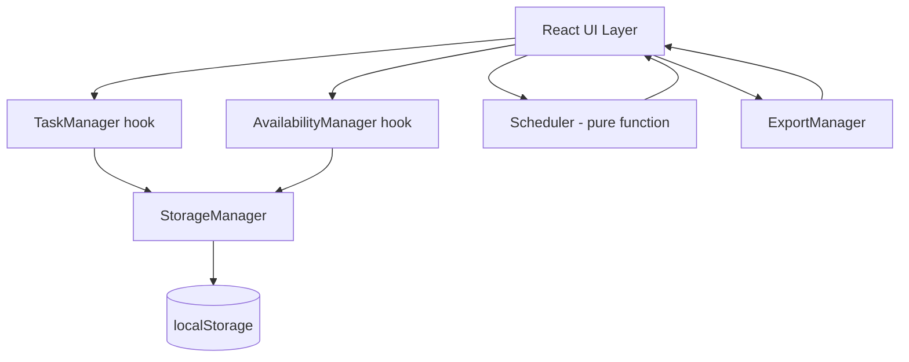
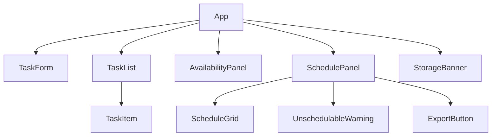

# Design Document: StudySprint

## Overview

StudySprint is a fully client-side, browser-based study planner. Students declare tasks (with deadlines, estimated effort, and priority) and their daily study availability. A deterministic pure-function scheduling engine distributes task work across available days, respects deadlines, and surfaces any work that cannot be placed. Everything persists in `localStorage`; there is no backend.

**Technology choices:**
- **TypeScript** — strict mode, for correctness at the type level
- **React 18** — component-based UI
- **Vite** — build tool / dev server
- **Vitest + fast-check** — unit tests and property-based tests
- **No external styling framework** — plain CSS with CSS custom properties for theming

**Key architectural constraints:**
- The scheduler is a pure function with zero side effects; it never reads the clock.
- The UI derives today's local date and passes it to the scheduler as a `YYYY-MM-DD` string.
- All date comparisons are lexicographic string comparisons; no UTC parsing.
- Task IDs are stable, auto-incrementing, and never reused.

---

## Architecture



**Layers:**

| Layer | Responsibility |
|---|---|
| React UI | Rendering, user events, date derivation, schedule invalidation |
| TaskManager (hook) | Task CRUD, validation, ID assignment |
| AvailabilityManager (hook) | Availability CRUD, validation |
| StorageManager | localStorage read/write, schema validation, error handling |
| Scheduler | Pure scheduling function, no I/O |
| ExportManager | JSON file download |

**State invalidation rule:** Any change to tasks or availability causes the UI to discard the current `ScheduleResult` and display a stale indicator. The user must explicitly trigger regeneration.

---

## Components and Interfaces

### React Component Tree



**Component responsibilities:**

- **`App`** — top-level state orchestrator; holds tasks, availability, scheduleResult, isScheduleStale
- **`TaskForm`** — add/edit form; manages field-level validation errors; emits validated task on submit
- **`TaskList`** — renders list of `TaskItem`; passes callbacks for complete/incomplete/edit/delete
- **`TaskItem`** — renders one task; shows overdue indicator when `deadline < today`
- **`AvailabilityPanel`** — date + minutes input; manages validation; updates availability map
- **`SchedulePanel`** — "Generate Schedule" button; renders `ScheduleGrid` and `UnschedulableWarning` when result is present; shows stale indicator
- **`ScheduleGrid`** — renders schedule entries grouped by day
- **`UnschedulableWarning`** — renders unschedulable minutes grouped by task name; only shown when any task has unschedulable > 0
- **`ExportButton`** — triggers JSON download; shows inline message when schedule is empty
- **`StorageBanner`** — persistent banner shown when localStorage is unavailable

### Scheduler Function Interface

```typescript
function schedule(
  tasks: Task[],
  availability: Availability,
  today: DateString
): ScheduleResult
```

---

## Data Models

### Core Types

```typescript
// YYYY-MM-DD string — no runtime parsing, comparisons are lexicographic
type DateString = string;

type Priority = 'High' | 'Medium' | 'Low';

// Priority numeric weight for sorting
const PRIORITY_WEIGHT: Record<Priority, number> = {
  High: 1,
  Medium: 2,
  Low: 3,
};

interface Task {
  id: number;               // stable, auto-incrementing, never reused
  title: string;            // 1–200 chars (trimmed)
  subject: string;          // 1–100 chars (trimmed)
  deadline: DateString;     // YYYY-MM-DD, local timezone
  estimatedMinutes: number; // 1–1440 positive integer
  priority: Priority;
  completed: boolean;
}

// Map from YYYY-MM-DD to available minutes (0–1440)
type Availability = Record<DateString, number>;

interface ScheduleEntry {
  taskId: number;
  taskTitle: string;
  subject: string;
  date: DateString;
  allocatedMinutes: number; // 1–1440
}

interface ScheduleResult {
  entries: ScheduleEntry[];
  unschedulable: Record<number, number>; // taskId → unschedulable minutes
}
```

### Persisted State Schema

```typescript
// localStorage key: studysprint_tasks
interface PersistedTasks {
  tasks: Task[];
  nextId: number; // also persisted under studysprint_next_id for robustness
}

// localStorage key: studysprint_availability
type PersistedAvailability = Availability;

// localStorage key: studysprint_next_id
type PersistedNextId = number;
```

### Validation Rules (enforced before any state mutation)

| Field | Rule |
|---|---|
| `title` | trimmed length 1–200 |
| `subject` | trimmed length 1–100 |
| `deadline` | valid calendar date string (rejects 2024-02-30 etc.) |
| `estimatedMinutes` | `Number.isSafeInteger(n) && n >= 1 && n <= 1440` |
| `priority` | one of `'High' \| 'Medium' \| 'Low'` |
| `availableMinutes` | `Number.isSafeInteger(n) && n >= 0 && n <= 1440` |

**Calendar date validation:** Parse `YYYY-MM-DD` by constructing a `Date` using local components and verifying the components round-trip (day-of-month does not overflow into the next month).

```typescript
function isValidCalendarDate(s: string): boolean {
  const m = /^(\d{4})-(\d{2})-(\d{2})$/.exec(s);
  if (!m) return false;
  const [, y, mo, d] = m.map(Number);
  const dt = new Date(y, mo - 1, d); // local constructor
  return (
    dt.getFullYear() === y &&
    dt.getMonth() === mo - 1 &&
    dt.getDate() === d
  );
}
```

### Scheduler Algorithm (pseudocode)

```
function schedule(tasks, availability, today):
  eligible = tasks
    .filter(t => !t.completed && t.estimatedMinutes > 0)
    .sort by (deadline ASC, PRIORITY_WEIGHT[priority] ASC, id ASC)

  if eligible is empty: return { entries: [], unschedulable: {} }

  latestDeadline = max(eligible.map(t => t.deadline))  // lexicographic max

  // Build mutable capacity map from today through latestDeadline
  capacity = {}
  for each day D from today to latestDeadline (inclusive):
    capacity[D] = availability[D] ?? 0

  entries = []
  unschedulable = {}

  for each task T in eligible:
    remaining = T.estimatedMinutes
    for each day D from today to T.deadline (inclusive):
      if capacity[D] <= 0: continue
      alloc = min(remaining, capacity[D])
      entries.push({ taskId: T.id, taskTitle: T.title, subject: T.subject,
                     date: D, allocatedMinutes: alloc })
      capacity[D] -= alloc
      remaining -= alloc
      if remaining === 0: break
    if remaining > 0:
      unschedulable[T.id] = remaining

  return { entries, unschedulable }
```

**Day enumeration** iterates by incrementing the local date (year/month/day arithmetic, no UTC), producing `YYYY-MM-DD` strings with zero-padded month and day.

```typescript
function addDays(date: DateString, n: number): DateString {
  const [y, m, d] = date.split('-').map(Number);
  const dt = new Date(y, m - 1, d + n);
  return formatLocalDate(dt); // YYYY-MM-DD zero-padded
}

function enumerateDays(from: DateString, to: DateString): DateString[] {
  const days: DateString[] = [];
  let cur = from;
  while (cur <= to) {  // lexicographic comparison
    days.push(cur);
    cur = addDays(cur, 1);
  }
  return days;
}
```

### StorageManager

```typescript
interface StorageManager {
  loadTasks(): { tasks: Task[]; nextId: number };
  saveTasks(tasks: Task[], nextId: number): void;
  loadAvailability(): Availability;
  saveAvailability(availability: Availability): void;
  isAvailable(): boolean; // false when localStorage is blocked
}
```

- All writes are synchronous within the 500 ms / 1000 ms SLA (localStorage is synchronous).
- On schema validation failure: discard the key's value, initialize empty, emit a warning event.
- When `localStorage` throws (SecurityError or QuotaExceededError): set `isAvailable = false`, operate in-memory, emit a persistent banner event.

---

## Correctness Properties

*A property is a characteristic or behavior that should hold true across all valid executions of a system — essentially, a formal statement about what the system should do. Properties serve as the bridge between human-readable specifications and machine-verifiable correctness guarantees.*

### Property 1: Daily Capacity

*For any* valid task list, availability map, and reference date, the sum of `allocatedMinutes` across all `ScheduleEntry` objects for any single date SHALL NOT exceed the available minutes for that date in the availability map. Dates absent from the map have zero capacity and SHALL receive no allocations.

**Validates: Requirements 9.1, 3.4, 3.5**

---

### Property 2: Deadline Compliance

*For any* valid task list, availability map, and reference date, no `ScheduleEntry` in the result SHALL have a `date` that is lexicographically greater than the `deadline` of the task referenced by that entry's `taskId`.

**Validates: Requirements 9.2, 3.6**

---

### Property 3: Conservation of Minutes

*For any* valid task list, availability map, and reference date, for every incomplete task with `estimatedMinutes > 0`, the sum of `allocatedMinutes` across all its `ScheduleEntry` objects plus the task's value in `unschedulable` SHALL equal exactly `estimatedMinutes`. This invariant holds regardless of whether the task is overdue, partially schedulable, or fully schedulable.

**Validates: Requirements 9.3, 4.1, 4.3**

---

### Property 4: Determinism

*For any* valid task list, availability map, and reference date, calling the scheduler twice with identical inputs SHALL produce two `ScheduleResult` values whose `entries` arrays are deeply equal (same `taskId`, `date`, and `allocatedMinutes` per entry, in the same order) and whose `unschedulable` maps are deeply equal.

**Validates: Requirements 9.4, 3.9**

---

### Property 5: Exclusion of Completed Tasks

*For any* valid task list containing at least one completed task, the scheduler SHALL produce a `ScheduleResult` whose `entries` array contains no `ScheduleEntry` whose `taskId` matches a task with `completed === true`. Completed tasks SHALL also not appear in the `unschedulable` map.

**Validates: Requirements 9.5, 3.2**

---

### Property 6: Non-negativity of Allocated Minutes

*For any* valid task list, availability map, and reference date, every `allocatedMinutes` value in every `ScheduleEntry` in the result SHALL be a positive integer strictly greater than zero.

**Validates: Requirements 9.6**

---

### Property 7: Overdue Tasks Have Zero Entries

*For any* valid task list where at least one incomplete task has a deadline strictly before the reference date, the scheduler SHALL include zero `ScheduleEntry` objects for those tasks, and their `estimatedMinutes` SHALL appear entirely in `unschedulable` (conservation invariant still holds).

**Validates: Requirements 9.7, 4.1**

---

### Property 8: Empty Input Yields Empty Schedule

*For any* reference date and availability map, when the task list is empty or all tasks have `completed === true`, the scheduler SHALL return a `ScheduleResult` with an empty `entries` array and an empty `unschedulable` map.

**Validates: Requirements 9.8, 3.10**

---

## Error Handling

### Validation Errors (form-level)
- Each field has an independent error state (string | null).
- Errors are set on submit attempt and cleared field-by-field as the user corrects input.
- Error messages are associated with their input via `aria-describedby` (Requirement 8.6).
- Invalid submissions leave the previously saved task state unchanged (Requirement 1.11).

### Storage Errors
| Scenario | Behavior |
|---|---|
| `localStorage` blocked (SecurityError) | Operate in-memory; show persistent `StorageBanner` |
| QuotaExceededError on write | Show non-blocking toast warning; data may be partially written |
| Corrupt JSON on read | Discard the key, init empty, show non-blocking toast naming the key |
| Invalid schema on read | Same as corrupt JSON |
| Key missing on init | Silently init empty — no warning |

### Timezone Unavailable
- Detected when `Intl.DateTimeFormat().resolvedOptions().timeZone` is unavailable or throws.
- Show non-blocking error; block schedule generation (Requirement 5.5).
- Task add/edit remain functional with a degraded date note.

### Export Errors
- Empty schedule → inline message on the Export button area; no download initiated.
- `document.createElement('a')` / `URL.createObjectURL` failure → catch and show error message.

---

## Testing Strategy

### Unit Tests (Vitest)

Focus on specific examples, edge cases, and boundary conditions:

- **Scheduler**: overdue task (all unschedulable), exactly-filled day, task spanning multiple days, priority tie-breaking, tasks with `estimatedMinutes <= 0` skipped, empty availability, all tasks complete.
- **Validation**: boundary values (title length 200 vs 201, estimatedMinutes 1/1440/0/1441), invalid dates (2024-02-30, 2023-13-01), whitespace-only strings.
- **StorageManager**: corrupt JSON recovery, missing key init, schema mismatch, `localStorage` unavailable (mock).
- **ExportManager**: correct filename format (today's local date), correct JSON structure.
- **`isValidCalendarDate`**: leap year (2024-02-29 valid, 2023-02-29 invalid), month-end overflow.

### Property-Based Tests (Vitest + fast-check)

One test per correctness property. Each test runs a **minimum of 100 iterations**. Each test is tagged with a comment referencing the design property.

**Arbitraries needed:**
- `arbDateString` — generates valid `YYYY-MM-DD` strings within a reasonable window (e.g. ±2 years from a fixed reference)
- `arbPriority` — `fc.constantFrom('High', 'Medium', 'Low')`
- `arbTask` — generates a `Task` with valid fields; `completed` is randomized
- `arbTaskList` — `fc.array(arbTask, { minLength: 0, maxLength: 20 })` with unique IDs ensured
- `arbAvailability` — `fc.dictionary(arbDateString, fc.integer({ min: 0, max: 1440 }))`

**Property test structure (example for Property 3):**

```typescript
// Feature: studysprint, Property 3: Conservation of Minutes
it('conservation: allocatedMinutes + unschedulable = estimatedMinutes', () => {
  fc.assert(
    fc.property(arbTaskList, arbAvailability, arbDateString, (tasks, availability, today) => {
      const result = schedule(tasks, availability, today);
      const eligible = tasks.filter(t => !t.completed && t.estimatedMinutes > 0);
      for (const task of eligible) {
        const allocated = result.entries
          .filter(e => e.taskId === task.id)
          .reduce((s, e) => s + e.allocatedMinutes, 0);
        const unsch = result.unschedulable[task.id] ?? 0;
        expect(allocated + unsch).toBe(task.estimatedMinutes);
      }
    }),
    { numRuns: 100 }
  );
});
```

**Tag format for all property tests:**
```
// Feature: studysprint, Property {N}: {property title}
```

### Integration / Smoke Tests

- App initializes from localStorage and renders task list before any user interaction.
- Stale indicator appears after task mutation without regeneration.
- Full round-trip: add task → set availability → generate schedule → export → verify JSON structure.

### Accessibility
- Manual testing with keyboard-only navigation and a screen reader (NVDA / VoiceOver).
- Automated `axe-core` scan for aria attributes, label associations, and contrast (supplementary; not a substitute for manual review).
